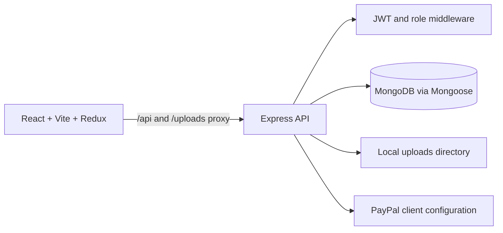

# MERN E-Commerce Store — Fork


This repository is a fork of [HuXn-WebDev/MERN-E-Commerce-Store](https://github.com/HuXn-WebDev/MERN-E-Commerce-Store), a tutorial-based MERN storefront. It contains a React/Vite client, Express API, and MongoDB models. Keep the upstream attribution and license terms; this fork should not be presented as wholly original work without clearly identifying your contributions.

## Implemented areas

- Product browsing, details, category filtering, favorites, and a Redux-backed cart.
- User registration, login, profile, and protected/admin frontend routes.
- Express/Mongoose API routes for users, products, categories, orders, and image uploads.
- Admin pages for product, category, user, and order management.
- A PayPal client configuration endpoint and frontend PayPal dependency.

The repository has no automated test suite in its package scripts. GitHub reports the fork's last push as January 2024, so review dependency health and security before using it beyond a local demonstration.

## Architecture



The API listens on port `5000` by default. Vite proxies `/api/` and `/uploads/` to that port during development. The repository's original default branch tracked a root `.env`; this branch removes it and adds a placeholder-only `.env.example`. If that file held credentials, treat them as exposed: revoke/rotate them and inspect account usage. Removing the file from this branch does not erase prior Git history.

## Structure

```text
backend/       Express entry point, MongoDB config, controllers, models, middleware, routes
frontend/      Vite + React pages, components, Redux state and API slices
thumb.png      Tutorial thumbnail
.env.example      Placeholder environment-variable reference
```

## Requirements and setup

- Node.js and npm.
- A MongoDB database (local or hosted).
- A PayPal client ID for the payment UI; keep provider secrets server-side.

Copy `.env.example` to an ignored local `.env` and set private values there:

```env
PORT=5000
MONGO_URI=mongodb://127.0.0.1:27017/mern_store
JWT_SECRET=replace-with-a-long-random-secret
PAYPAL_CLIENT_ID=your-sandbox-client-id
```

The checked-in example file includes `PORT`, `MONGO_URI`, `JWT_SECRET`, and `PAYPAL_CLIENT_ID`. Replace every placeholder locally; use a PayPal sandbox client ID for local payment-flow exploration. Do not put a PayPal secret in frontend code.

Install root dependencies from the repository root:

```powershell
npm install
npm install --prefix frontend
```

Start the backend and frontend in separate PowerShell terminals:

```powershell
# Terminal 1, repository root
npm run backend
```

```powershell
# Terminal 2, repository root
npm run frontend
```

Open the Vite URL shown in the terminal (normally `http://localhost:5173`). The Vite proxy forwards API requests to `http://localhost:5000`.

## Available scripts

```powershell
npm run backend
npm run frontend
npm run dev --prefix frontend
npm run build --prefix frontend
npm run lint --prefix frontend
```

The root `dev` script starts both services through `concurrently`; the malformed command string is corrected in this branch. The backend and frontend manifests do not define unit or integration test scripts. Use the frontend build and lint commands above for the checks currently available.

## API surface

The Express server mounts `/api/users`, `/api/category`, `/api/products`, `/api/upload`, and `/api/orders`, plus `/api/config/paypal`. Access varies by route: some operations require a JWT cookie and admin authorization. See `backend/routes/` and the associated controllers for request/response details. The upload route accepts image files and stores them locally under `uploads/`.

## Deployment and license

No Dockerfile or deployment configuration was found in the inspected tree. Production hosting must provide MongoDB, persistent image storage, HTTPS cookie/security settings, and protected environment variables. The root package metadata declares ISC, but no root `LICENSE` file was found in the fork; confirm the upstream license and preserve attribution before redistributing.
